# 🚀APILeakGuard🚀  

**AI Powered Autonomous Sensitive Data Leakage Detector for APIs**

APILeakGuard v1.0 is a Windows desktop app and command-line tool for running approved HTTP requests and checking responses, headers and saved logs for exposed secrets, personal data and internal details. Use it to repeat a functional test, investigate a finding, compare a field policy or verify a fix. Built-in scanning, policy checks and reporting work with AI turned off. When you enable AI, the assistant can explain findings and propose supported app actions for your review.

[v1.0 release](https://github.com/The-Real-Virus/APILeakGuard/releases/tag/v1.0) · [Windows x64 portable ZIP](https://github.com/The-Real-Virus/APILeakGuard/releases/download/v1.0/APILeakGuard-v1.0-windows-x64-portable.zip) · [Word handbook](Documentation.docx)

## Download and run

Download the [portable ZIP](https://github.com/The-Real-Virus/APILeakGuard/releases/download/v1.0/APILeakGuard-v1.0-windows-x64-portable.zip) and [SHA256SUMS.txt](https://github.com/The-Real-Virus/APILeakGuard/releases/download/v1.0/SHA256SUMS.txt). The package includes Python and Qt. A standard Windows user account and a writable folder are enough to start. The executables are unsigned. Open PowerShell in the download folder to check the ZIP.

```powershell
(Get-FileHash .\APILeakGuard-v1.0-windows-x64-portable.zip -Algorithm SHA256).Hash
```

Expected SHA-256

```text
621349020825a39c9d04ac70297a68e25f2b2b0d1d91612107d248885fcd34a3
```

After the hash matches, extract the entire ZIP and double-click `APILeakGuard.exe`. Keep `apileakguard-cli.exe`, `_internal/` and `portable.profile` together in the extracted folder. The app creates a `profile/` workspace beside the executables for local settings, approvals, run history and masked reports. You can select a separate workspace with `--workspace`.

## Quick start

1. Open **Overview → Run practice request**. Check HTTP 200, select the sample email finding and choose **Open source** to view the masked response.
2. To try a public API, open **Manual request**, choose **GET**, enter `https://api.github.com/repos/octocat/Hello-World`, and leave **No authentication** selected. Use **Preview request → Approve and run → Allow**. The verified run returned HTTP 200 with JSON. For an API you are authorized to test, use its documented method, endpoint URL and authentication.
3. For repeat runs, use **Automated tests** to start from a URL, prepare a suite from imported definitions or open an existing suite. Review the effective destinations, credentials and required variables, then approve the plan.
4. To scan responses or logs you already have, use **Imported evidence → Preview files → Analyze files**. Switch between **Pretty** and **Raw** in the results. Use **Policy comparison** to evaluate a selected policy against the saved run.
5. Export a masked HTML, JSON or CSV report. Use **Remediation** to preview, verify or roll back a supported edit to a selected local JSON file.

Authenticated remote requests use HTTPS. APILeakGuard permits anonymous GET and HEAD on an explicitly selected private HTTP lab endpoint with limited request inputs. The response status and the findings answer different questions. A 403 can reflect the server’s permissions or request filtering.

### Try the CLI

Open PowerShell in the extracted `APILeakGuard-v1.0` folder. These commands scan a bundled synthetic file and list the saved run. The scan is local and the sample policy deliberately produces a finding with exit code `2`.

```powershell
.\apileakguard-cli.exe --version
.\apileakguard-cli.exe --workspace .\demo-profile analyze `
  .\fixtures\support-exposed.json --policy .\fixtures\support-policy.json
$LASTEXITCODE
.\apileakguard-cli.exe --workspace .\demo-profile runs
```

Use `--help` or a subcommand’s `--help` for the full arguments. The [Markdown handbook](Source%20code/docs/HANDBOOK.md) covers CLI approvals and a CI example that goes from a failing scan to a passing one.

## Authentication and optional AI

- For a single authorized request, choose **Bearer token** and use the masked token field. For repeat runs, create a profile in **Settings** and match its project, API and environment. Windows DPAPI protects saved API credentials for the current Windows user.
- To enable chat, open **AI assistant**, select the provider, and enter a provider key or choose **Load key file…**. Click **Discover chat models** and send a message. Review consent before the first request to the selected model. Review proposed local actions before running them. Model availability, limits and charges depend on your provider.
- Reports and normal copying use masked evidence. Use local original reveal only for a selected source you are authorized to inspect. Keep credentials, private captures and profiles out of shared files.

## Troubleshooting

| Result | What to check |
| --- | --- |
| HTTP 200 with HTML | Copy the documented API endpoint path if you expected JSON. A website page commonly returns HTML. |
| HTTP 401 | Check the token, expiry and authentication profile for that endpoint. |
| HTTP 403 | Check the response body in **Results and evidence → Evidence** for role, permission or site filtering details. |
| HTTP 404 | Check the full path, API version, method and any substituted identifiers. |
| No HTTP response | Read the connection error and check reachability, DNS, the port or TLS on the Windows host. |
| AI provider quota or service error | Review the provider message. The app preserves your draft so you can retry or choose another available model. |

## Supported inputs

- OpenAPI 3.0 and 3.1 in JSON or YAML, with supported local references and response schemas.
- Postman Collection v2.1, saved responses, Postman environment metadata, and Newman JSON execution reports.
- Insomnia JSON v4 and HAR 1.2.
- Standalone response JSON, native JSON and NDJSON, and mapped CSV.

Request definitions show the operations that can be tested. Saved responses and logs provide observed evidence. Imported scripts are inert. Review file previews for format warnings and missing coverage.

## Windows and provider verification

The x64 package targets Windows 10 and Windows 11. The exact native host verified for v1.0 was **Windows 11 Pro 22H2 x64, build 22621.4317**. The final Windows regression suite passed 31 tests. Additional Windows configurations, including Windows 10, remain deferred.

AI is optional and disabled by default. OpenAI, Anthropic Claude and Google Gemini passed automated contract tests. Gemini also passed live discovery, plain-text conversation, follow-up and a reviewed in-app action with `gemini-3.1-flash-lite`. Live OpenAI and Claude and the signed-in crAPI check remain deferred.

## Repository layout

| Path | Contents |
| --- | --- |
| [Documentation.docx](Documentation.docx) | Word handbook with walkthroughs, desktop controls, CLI examples and troubleshooting |
| [Source code/apileakguard/](Source%20code/apileakguard/) | Desktop and CLI, request execution, evidence imports, scanner, policies, reports and provider adapters |
| [Source code/assets/](Source%20code/assets/) | Desktop icons and Windows version resources |
| [Source code/docs/](Source%20code/docs/) | Text handbook, control reference, operation permissions and remaining tests |
| [Source code/fixtures/](Source%20code/fixtures/) | Synthetic evidence, example policies and a project scope |
| [Source code/scripts/](Source%20code/scripts/) | Build and test scripts, packaging and optional provider smoke checks |
| [Source code/tests/](Source%20code/tests/) | Regression tests and a synthetic local API used in tests |
| [Source code/requirements-win-x64.lock](Source%20code/requirements-win-x64.lock) | Versioned dependencies and wheel hashes |
| [v1.0 release assets](https://github.com/The-Real-Virus/APILeakGuard/releases/tag/v1.0) | Portable ZIP, release notes, build manifest and SHA-256 checksums |

## Build and test

To build from source, use Windows x64, PowerShell and a **full CPython 3.12.14 x64** environment with `venv`. The bootstrap script checks the exact version and verifies the wheel hashes in the lockfile. CPython 3.12.14 is a source-only release on python.org. If you need a prebuilt Windows interpreter, install Astral’s `uv` tool and use its managed Python. [CPython 3.12.14 release](https://www.python.org/downloads/release/python-31214/) · [Install uv](https://docs.astral.sh/uv/getting-started/installation/)

```powershell
# Run from the repository root. These first two commands use uv if needed.
uv python install 3.12.14
$basePython = (uv python find --managed-python 3.12.14).Trim()

Set-Location -LiteralPath '.\Source code'
.\scripts\Bootstrap.ps1 -BasePython $basePython
.\scripts\Test.ps1
.\scripts\Build.ps1
```

If the exact Python version is already installed, set `$basePython` to its full `python.exe` path and start with `Set-Location`. On an offline machine, pass `-Wheelhouse` to `Bootstrap.ps1` with the matching predownloaded wheels.

`Test.ps1` runs the regression suite, including loopback HTTP and provider contract tests, and saves the transcript under `.work/evidence/`. `Build.ps1` writes the portable ZIP, manifest and checksums to `Source code/release/`. Unpack your build and rerun the practice request and CLI sample to check it. Use the [published release manifest](https://github.com/The-Real-Virus/APILeakGuard/releases/download/v1.0/manifest.json) to verify the official package. Record your Python distribution when comparing a local build with the published binaries.

The approved source fingerprint is `37f331625702743a1a64e15692329556ccf3a6ee5c7c465ed9aa5c57de2fe68d`. See the [source README](Source%20code/README.md) for project-local build and CLI details.  

## VISUAL APPLICATION  

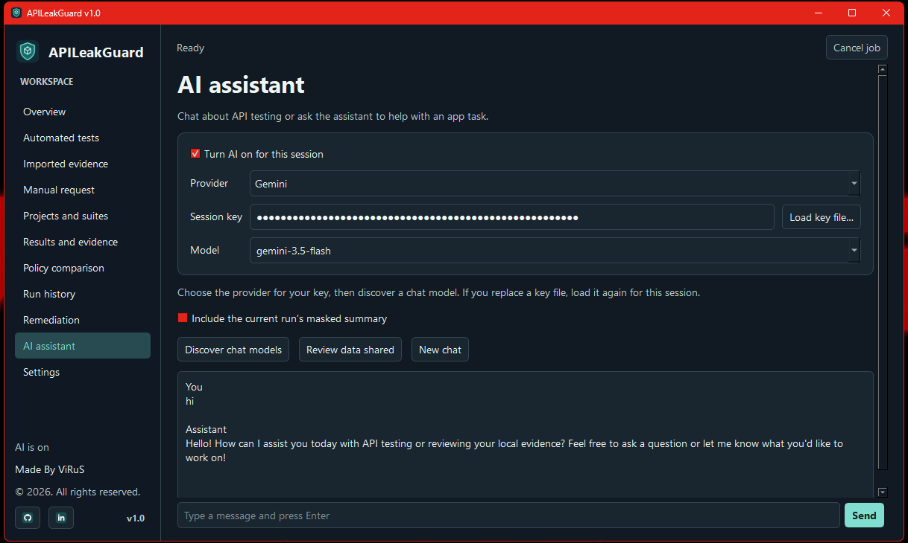

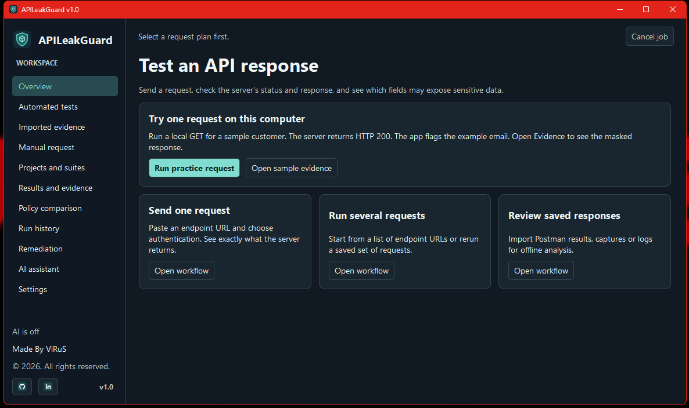

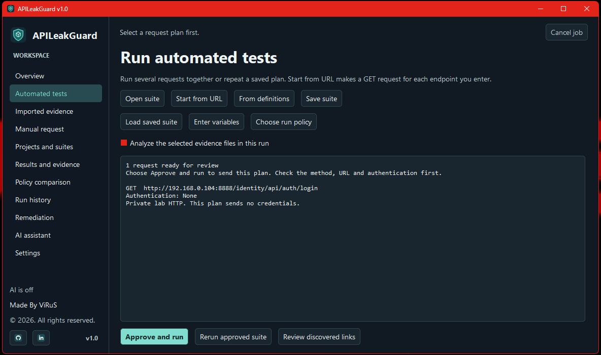

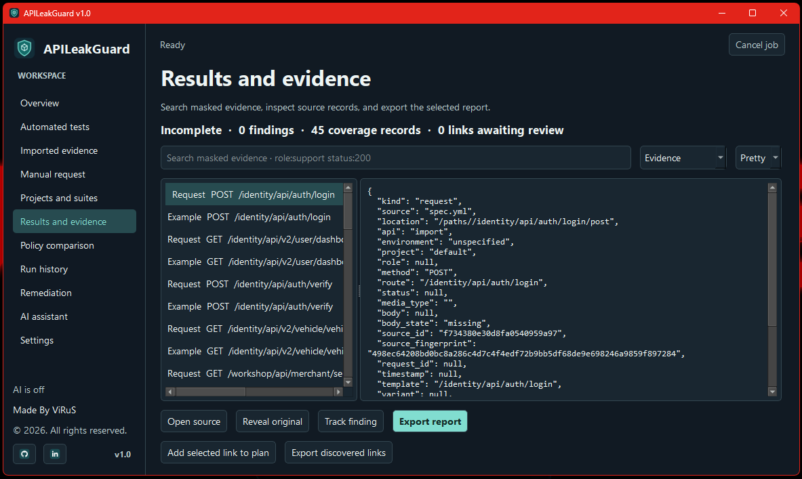

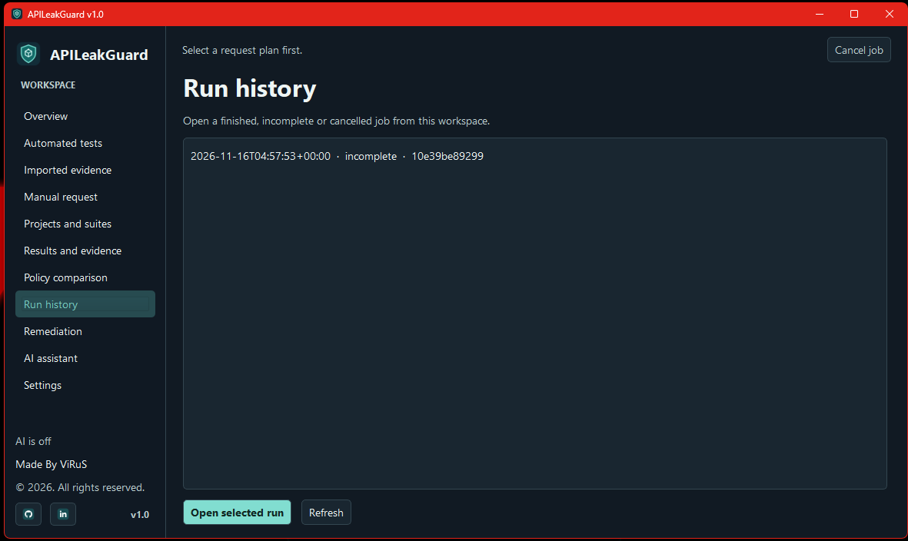

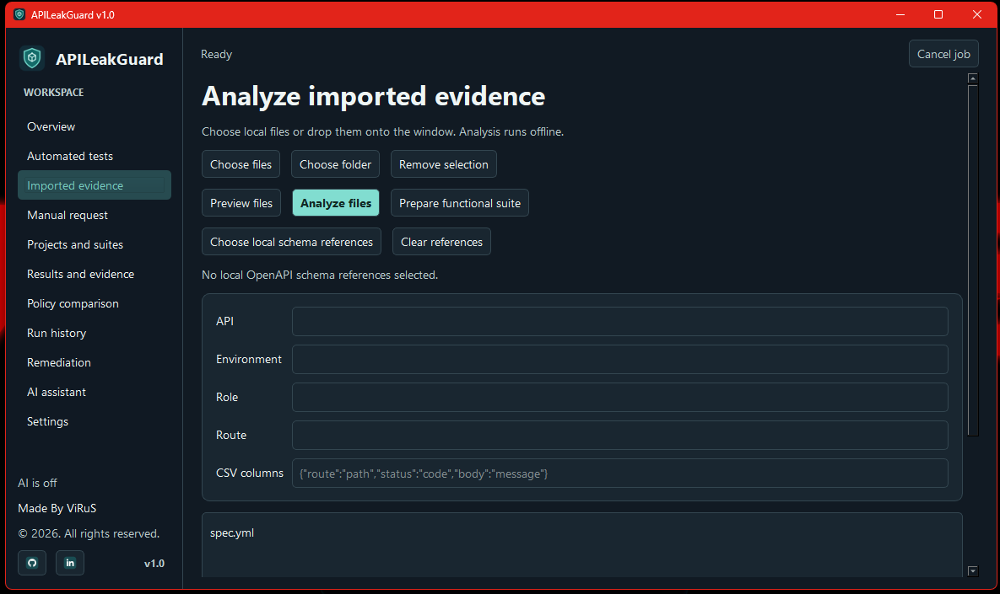

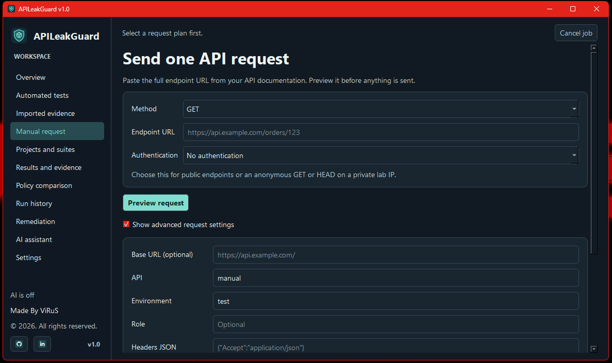

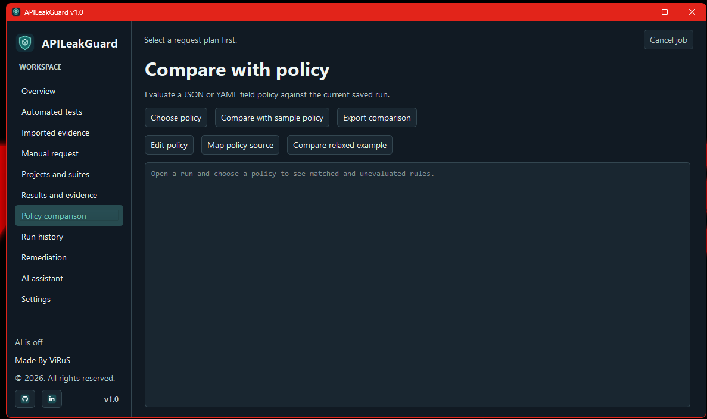

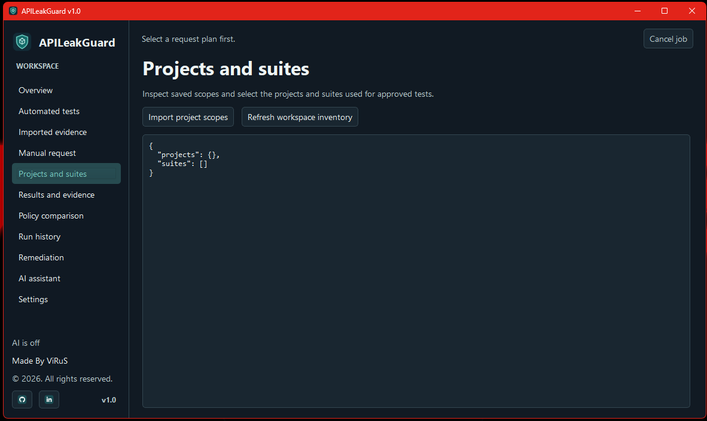

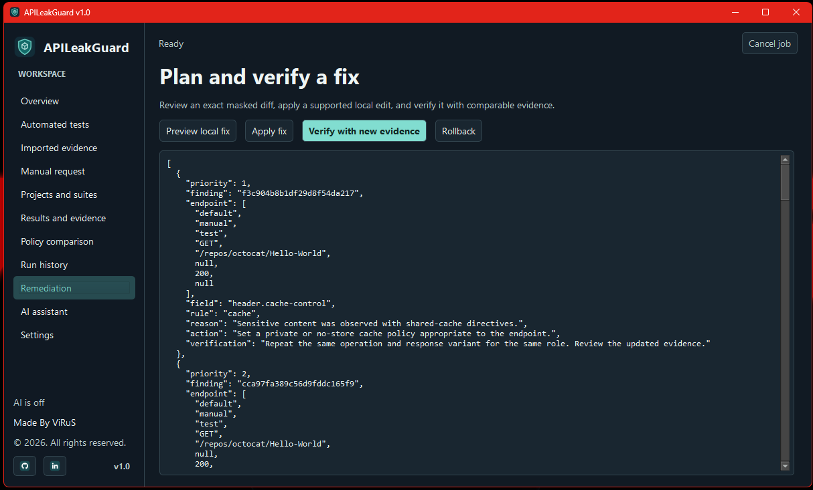

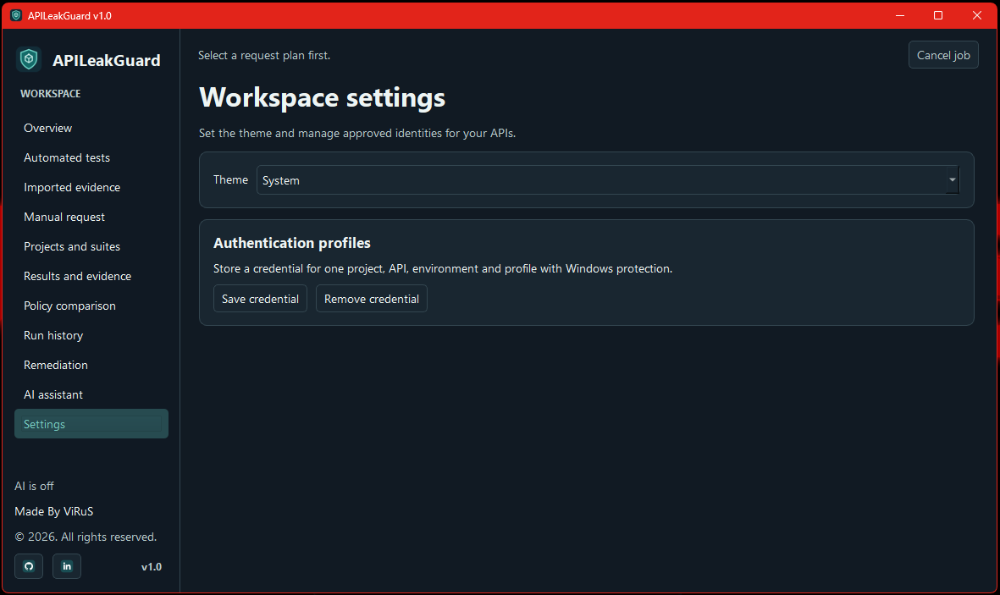

## Contributing

Use the [remaining tests](Source%20code/docs/REMAINING-TESTS.md) to reproduce deferred checks. Include the Windows build, the exact ZIP or source hash, the workflow you ran, and masked or synthetic evidence when [reporting an issue](https://github.com/The-Real-Virus/APILeakGuard/issues). See the [desktop controls](Source%20code/docs/DESKTOP-CONTROLS.md) and [operation permissions](Source%20code/docs/OPERATIONS.md).  

---

> [!IMPORTANT]
> Building Stuff Like This From Scratch With Agents & LLMs. Need Skills, Knowledge and Creativity. Its An ART, Not Everyone is a Master oF TECH ! && Cybersecurity is Never Ending Game ~  

## Credits and license

Made By ViRuS. © 2026. All rights reserved. See the [license](LICENSE) and [third-party notices](Source%20code/THIRD-PARTY-NOTICES.md).

[APILeakGuard repository](https://github.com/The-Real-Virus/APILeakGuard) · [Creator GitHub profile](https://github.com/The-Real-Virus) · [LinkedIn](https://www.linkedin.com/in/syed-muhammad-shah)
